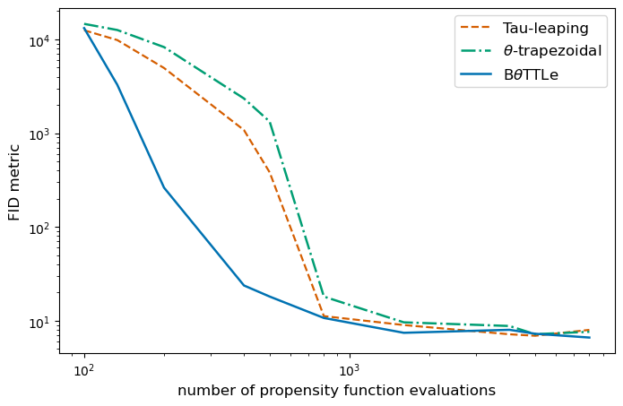

<h1 align='center'>Code for the paper "A binomial-adjusted θ-trapezoidal tau-leaping method 
for chemical kinetic systems"</h1>
<h2 align='center'>by Maximilian Scott, Sam McCallum and James Foster</h2>


The paper is available at https://arxiv.org/abs/2611.16975 .

This repository contains code for simulating chemical reaction systems using tau-leaping 
methods, in particular the BθTTLe numerical scheme. For example, consider the standard 
tau-leaping, θ-trapezoidal and BθTTLe methods applied to a kinetic model with 11 reacting 
species and 11 reaction channels. We compare the distribution of their endpoints to that of an 
exact sampling method (SSA) using the Fréchet Inception Distance (FID), as a function of the 
number of propensity function evaluations.

<p align="middle">
    
</p>


## Installation

The code was developed using Python 3.12. To install the dependencies run

```bash
pip install -r requirements.txt
```


## Reproducing the experiments

Both experiments should be run from the root of the repository:

```bash
python -m experiments.experiment_1    # heated monosaccharide-casein system
python -m experiments.experiment_2    # protein aggregation model
```

Each script samples the SSA and the three tau-leaping methods, then saves its figures to 
`experiments/`.


## Using your own reaction systems

Reaction systems are stored as CSV files containing the initial species counts, reaction rate 
constants and stoichiometry matrix. See `data/README.md` for the format. Propensities follow 
mass-action kinetics computed from the net stoichiometry, so reactions with at most three 
reactant molecules are supported and catalysts (species appearing on both sides of a reaction) 
cannot be represented.
